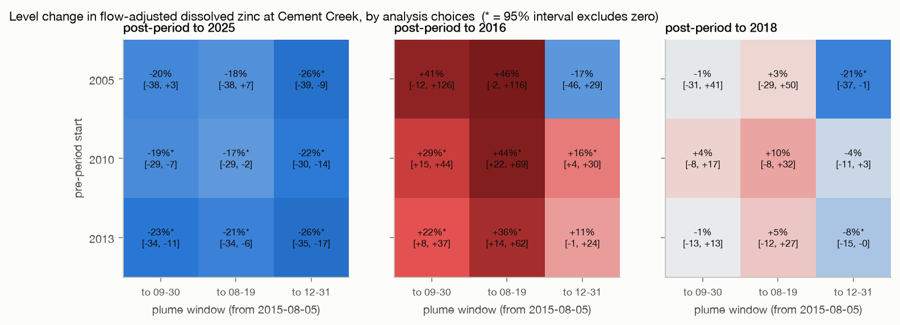

# Animas River after Gold King

Did the 5 August 2015 Gold King Mine release leave a lasting, flow-adjusted signal in
Cement Creek and the Animas River, and can any change be told apart from the Gladstone
treatment plant that started treating the same discharge two months later? A
pre-registered interrupted time series on public USGS and Water Quality Portal data,
built and verified under the [cairn](https://github.com/ethannol/cairn) harness.

## What the analysis shows

The primary analysis does not detect a lasting change in dissolved zinc at Cement
Creek after the release. The result changes with the analysis window, and the
nearby treatment plant started too soon afterward to separate its effect from the
spill in a monthly series.

This study works through flow adjustment, censored measurements, interrupted time
series, and sensitivity to the comparison period.

[Read the report](reports/report.md) · [Five-minute walkthrough](docs/walkthrough.md) · [Reproduce the analysis](#setup)



<details>
<summary>Detailed findings and estimates</summary>

All estimates below are rendered from the recorded results in `artifacts/numbers.json`.


- Headline cell, dissolved zinc in Cement Creek (Colorado River Watch monthly samples,
  245 samples 2005 to 2025, USGS gauge `09358550` discharge): flow-adjusted
  level change at the release -20 percent (interval
  -38 to 3,
  p = 0.08). Pre-registered verdict:
  **no detectable lasting change**.
- The verdict depends on the pre-period: starting it in 2010 gives
  -19 percent (-29 to
  -7) and in 2013 -23
  percent (-34 to -11);
  the 2005 pre-period carries a rising trend of 3.0
  percent per year that the counterfactual extrapolates. Ending the post-period in 2016
  flips the sign to 41 percent.
  See `reports/figures/sensitivity_grid.png`.
- Blind change-points do not sit at the release: the strongest split is
  2010-03 (-65 months from
  it); on the series with three coding artefacts removed the strongest split is
  2016-02, 6 months after the
  release and 4 months after the treatment plant started.
- The upstream control's pre-registered change (-21
  percent) is driven by 3 zero-valued "non-detects";
  without them it is -11 percent
  (-27 to 9).
  The difference-in-differences level change is -24 percent
  (-42 to -1) with a
  differential downward slope after 2015.
- Across 64 reach x constituent x fraction cells, 52 are
  estimable, 7 have raw p below 0.05 and 0 survive
  false-discovery control.
- Sampling at the four Silverton-to-Durango reaches went from 59.2
  to 129 events a year in the two years after the plant
  started. Pooling the organisations that began then gives a level change of
  -40 percent, about double the single-organisation
  estimate; the design uses one organisation across the release for that reason.

Read the [full report](reports/report.md) or the [five-minute walkthrough](docs/walkthrough.md).

</details>

## What is not claimed

No attribution of any change to the release: the release and the treatment plant start
are two months apart, inside the resolution of a monthly series. No health, ecological,
compliance or legal conclusion. No claim about any single cell in the multiplicity grid.
Stage-two intervals do not carry stage-one estimation error.

## Setup

Requires Python 3.12 and [uv](https://docs.astral.sh/uv/). From the cloned repository:

```bash
python3 scripts/bootstrap.py
```

This installs dependencies from the lockfile and checks out Cairn at the study's
recorded revision (`a184e0732989373856039dea2919ccd96a88e8b1`) in `../cairn-animas-baseline`.
It leaves existing checkouts untouched and refuses a baseline folder with a different
revision or uncommitted changes. The initial installation needs network access.

To reproduce the analysis after installation:

```bash
uv run pytest                # focused tests of every model component
uv run cairn run             # scripts/00..80 in order, offline, from the committed snapshot
uv run cairn verify          # frozen plan, checks, lint, placeholders, clean rerun
uv run cairn render          # reports/report.md from report.tmpl.md and the ledger
uv run python scripts/download.py   # ONLY to refresh the snapshot (network); re-freeze after
```

After installation, the analysis runs offline from the committed data snapshot.

## Data provenance

- `data/raw/query.json` is the query; `data/raw/manifest.json` records for every file the
  URL, date, HTTP headers, SHA-256, bytes and row count, plus probes of the alternatives.
- Water quality: Water Quality Portal legacy `/data/Result/search`, profile
  `resultPhysChem` (38236 rows). The WQX3 `fullPhysChem` profile
  returned 35668 rows for the same query, missing every USGS row.
- Discharge: USGS Water Data API `ogcapi/v0/collections/daily` (api-version
  0.80.8), 39751 daily values; the legacy
  `waterservices.usgs.gov/nwis/dv` endpoint still answered (HTTP 200)
  and was not used.
- Reaches and roles: Cement Creek at Silverton (impacted), Animas above Cement Creek
  (control), Animas below Silverton (impacted), Animas at Durango and near Cedar Hill
  (downstream). Field dictionary: `data/dictionary/wqp_fields.csv` (reused from the
  groundwater-audit sibling). Data dictionary: `docs/data_dictionary.md`.
- Exclusion log: `data/derived/exclusion_log.csv` and `data/derived/excluded.csv`.

## Layout

```
src/animas/      acquire, units, prepare, censored (Tobit + Newey-West), cq, its, changepoint, analysis, figures
scripts/         00_snapshot 10_prepare 20_coverage 30_cq 40_its 50_changepoint 60_did 70_exploratory 80_render_docs; download.py
data/raw/        committed public snapshot (immutable, hashed by cairn freeze)
data/derived/    sample table, QC, flow, exclusion log, daily discharge, sites
artifacts/       numbers.json (ledger), checks.jsonl
reports/         report.md (rendered), figures/, tables/
docs/            prereg.md (frozen), decisions.md, data_dictionary.md, walkthrough.md, resume_bullet.md
tests/           17 pytest tests
```

## How AI was used

This project was built in a Claude Code session with Claude Fable 5.1 from the project
brief: the agent verified the endpoints and the confounder timeline against published
sources, wrote the acquisition, preparation, models, tests, scripts and templates, and ran
the pipeline under cairn. The author reviewed the pre-registration, the tests and the
findings. No language model is called by the pipeline.

## License

MIT for the code. USGS data are public domain; partner data are as published through the
Water Quality Portal.


## Supplementary uncertainty and timeline

Headline intervals are conditional on the fitted first-stage concentration-discharge adjustment; they omit its estimation error. An [exploratory full two-stage calendar-block sensitivity](docs/two-stage-uncertainty.md) refits both stages without replacing the frozen primary results. The [release, treatment and sampling timeline](docs/timeline.md) explains why attribution remains unresolved.
